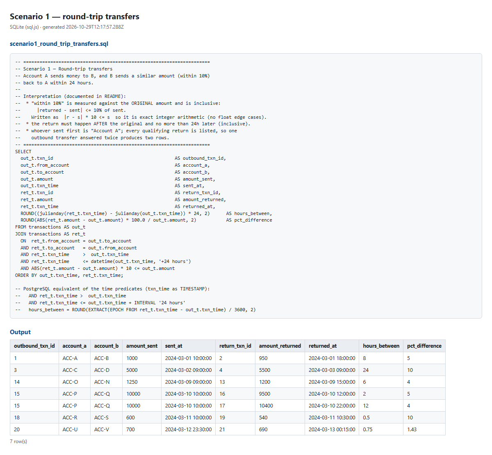
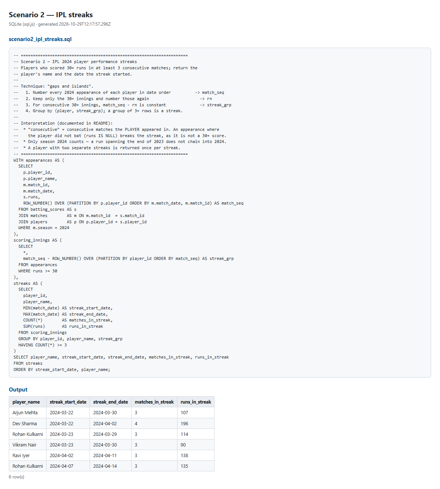

# SQL results

Generated by `npm run sql` on 2026-10-29T12:17:57.277Z (SQLite via sql.js).

## Scenario 1 — round-trip transfers

Query: [`sql/scenario1_round_trip_transfers.sql`](../../sql/scenario1_round_trip_transfers.sql)

| outbound_txn_id | account_a | account_b | amount_sent | sent_at | return_txn_id | amount_returned | returned_at | hours_between | pct_difference |
|---|---|---|---|---|---|---|---|---|---|
| 1 | ACC-A | ACC-B | 1000 | 2024-03-01 10:00:00 | 2 | 950 | 2024-03-01 18:00:00 | 8 | 5 |
| 3 | ACC-C | ACC-D | 5000 | 2024-03-02 09:00:00 | 4 | 5500 | 2024-03-03 09:00:00 | 24 | 10 |
| 14 | ACC-O | ACC-N | 1250 | 2024-03-09 09:00:00 | 13 | 1200 | 2024-03-09 15:00:00 | 6 | 4 |
| 15 | ACC-P | ACC-Q | 10000 | 2024-03-10 10:00:00 | 16 | 9500 | 2024-03-10 12:00:00 | 2 | 5 |
| 15 | ACC-P | ACC-Q | 10000 | 2024-03-10 10:00:00 | 17 | 10400 | 2024-03-10 22:00:00 | 12 | 4 |
| 18 | ACC-R | ACC-S | 600 | 2024-03-11 10:00:00 | 19 | 540 | 2024-03-11 10:30:00 | 0.5 | 10 |
| 20 | ACC-U | ACC-V | 700 | 2024-03-12 23:30:00 | 21 | 690 | 2024-03-13 00:15:00 | 0.75 | 1.43 |

## Scenario 2 — IPL streaks

Query: [`sql/scenario2_ipl_streaks.sql`](../../sql/scenario2_ipl_streaks.sql)

| player_name | streak_start_date | streak_end_date | matches_in_streak | runs_in_streak |
|---|---|---|---|---|
| Arjun Mehta | 2024-03-22 | 2024-03-30 | 3 | 107 |
| Dev Sharma | 2024-03-22 | 2024-04-02 | 4 | 196 |
| Rohan Kulkarni | 2024-03-23 | 2024-03-29 | 3 | 114 |
| Vikram Nair | 2024-03-23 | 2024-03-30 | 3 | 90 |
| Ravi Iyer | 2024-04-02 | 2024-04-11 | 3 | 138 |
| Rohan Kulkarni | 2024-04-07 | 2024-04-14 | 3 | 135 |

